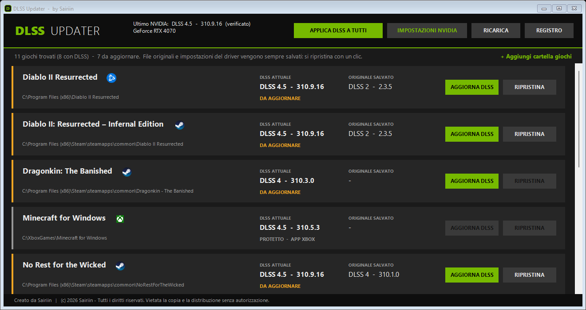
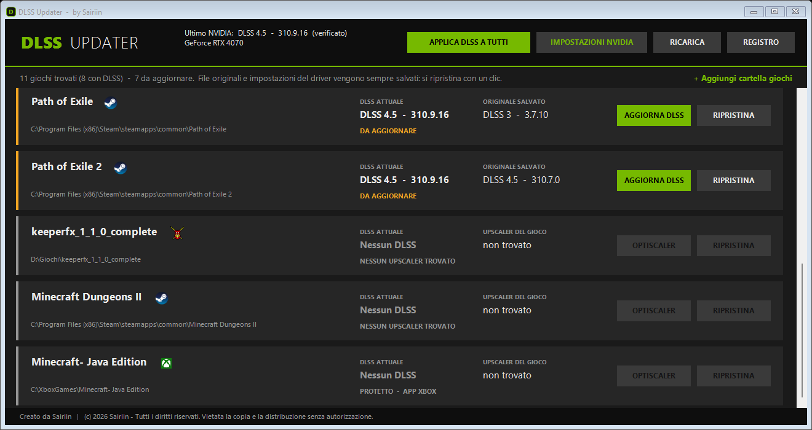
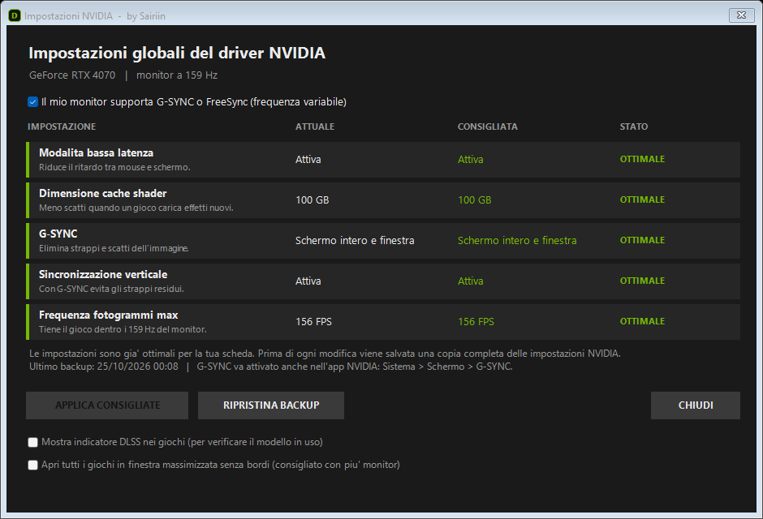

# DLSS Updater

**by Sairiin**

Programma per Windows che porta i tuoi giochi all'**ultimo DLSS ufficiale NVIDIA** con un clic, ottimizza le impostazioni del driver per giocare e, nei giochi single player che hanno solo FSR o XeSS, permette di usare il DLSS tramite OptiScaler.

Tutto quello che modifica viene **salvato prima**: con **Ripristina** ogni gioco torna esattamente com'era.

> *English summary at the bottom of this page.*

---

## Cosa fa

### Aggiorna DLSS
Per ogni gioco che usa il DLSS, il pulsante **AGGIORNA DLSS**:
1. sostituisce il file del DLSS del gioco (`nvngx_dlss.dll`) con l'**ultima versione ufficiale**, scaricata dalla pagina GitHub di NVIDIA ([github.com/NVIDIA/DLSS](https://github.com/NVIDIA/DLSS)). Il file viene usato **solo se è firmato digitalmente da NVIDIA**;
2. attiva nel **profilo del gioco del driver NVIDIA** l'"Override DLSS" con il **modello più recente**, come fa l'"Override DLSS" dell'app NVIDIA. Così il gioco usa il modello nuovo anche in modalità *Qualità*.

**APPLICA DLSS A TUTTI** fa la stessa cosa su tutti i giochi in un colpo solo.

Per ogni gioco il programma mostra il tipo di DLSS (DLSS 2, 3, 4, 4.5) attuale e quello originale salvato.

### Giochi con anti-cheat
Nei giochi con EasyAntiCheat, BattlEye e simili **il file del gioco non viene mai toccato**: si attiva solo l'override nel driver NVIDIA, che non modifica i file del gioco (è lo stesso meccanismo dell'app NVIDIA).

### Giochi senza DLSS: OptiScaler
Il programma elenca **tutti i giochi installati** (Steam, Epic, GOG, Battle.net, Ubisoft, EA, Rockstar, Xbox e cartelle aggiunte a mano) e indica se usano DLSS, FSR o XeSS.

Per i giochi che hanno **solo FSR o XeSS** c'è il pulsante **OPTISCALER**: scarica l'ultima versione ufficiale di [OptiScaler](https://github.com/optiscaler/OptiScaler) (progetto open source, GPL-3.0) e la installa nel gioco, impostando il DLSS come upscaler.

> ⚠️ **OptiScaler inietta codice nel gioco: usalo solo nei giochi single player / offline.** Nei giochi online rischi il ban dell'account. Il programma lo blocca nei giochi con anti-cheat e chiede sempre conferma.

### Impostazioni NVIDIA
Il pulsante **IMPOSTAZIONI NVIDIA** legge le impostazioni globali del driver e le confronta con quelle consigliate per giocare:

| Impostazione | Consigliata |
|---|---|
| Modalità bassa latenza | Attiva |
| Dimensione cache shader | 100 GB |
| G-SYNC *(se il monitor lo supporta)* | Schermo intero e finestra |
| Sincronizzazione verticale *(con G-SYNC)* | Attiva |
| Frequenza fotogrammi max *(con G-SYNC)* | 3 FPS sotto la frequenza del monitor |

**APPLICA CONSIGLIATE** le imposta dopo aver salvato una **copia completa** di tutte le impostazioni NVIDIA; **RIPRISTINA BACKUP** torna indietro.

Nella stessa finestra:
- **Mostra indicatore DLSS nei giochi**: l'indicatore ufficiale NVIDIA che mostra nel gioco versione e preset del DLSS in uso (per verificare che l'aggiornamento funzioni);
- **Apri tutti i giochi in finestra massimizzata senza bordi**: utile con più monitor. Quando un gioco è in modalità *Finestra*, il programma toglie i bordi e lo allarga a tutto il monitor su cui si trova. Il programma deve restare aperto (resta attivo vicino all'orologio).

---

## Requisiti
- **Windows 10 o 11**
- **Scheda NVIDIA RTX** (serie 20, 30, 40 o 50). Su GTX, AMD e Intel il DLSS non esiste: il programma lo segnala e non modifica nulla.
- Connessione a internet (solo per scaricare DLSS e OptiScaler dalle pagine ufficiali)

Non serve installare altro: è uno script PowerShell, già presente in Windows.

## Installazione e uso
1. Scarica il progetto: pulsante verde **Code → Download ZIP**, oppure dalla sezione **Releases**.
2. Estrai la cartella (per esempio in *Documenti*).
3. Doppio clic su **`Avvia DLSS Updater.cmd`**.
   - Se Windows mostra *"Windows ha protetto il PC"*: **Ulteriori informazioni → Esegui comunque** (succede con tutti i file scaricati da internet senza firma digitale).
   - Alla domanda *"Consentire modifiche?"* rispondi **Sì**: servono i permessi per scrivere nelle cartelle dei giochi e nel driver.
4. **Chiudi il gioco**, poi premi **AGGIORNA DLSS** (o **APPLICA DLSS A TUTTI**).
5. Nel gioco attiva il DLSS dalle opzioni grafiche.

Se un gioco non compare: **+ Aggiungi cartella giochi** e scegli la cartella dove sono installati.

## Sicurezza e trasparenza
- **Nessun file scaricato da fonti non ufficiali**: DLSS solo da `github.com/NVIDIA/DLSS` (con verifica della firma NVIDIA), OptiScaler solo dalla sua pagina ufficiale.
- **Nessun file NVIDIA o OptiScaler è incluso** in questo repository: vengono scaricati dalle fonti ufficiali sul tuo PC.
- **Backup di tutto**: file originali dei giochi, profili del driver NVIDIA (copia completa prima di ogni modifica), file sovrascritti da OptiScaler.
- **Registro**: il file `registro.log` elenca ogni operazione eseguita.
- Le impostazioni del driver vengono lette e scritte tramite NVAPI (`nvapi64.dll`, installata con il driver), usando i codici ufficiali pubblicati da NVIDIA in [github.com/NVIDIA/nvapi](https://github.com/NVIDIA/nvapi).
- Il codice è tutto leggibile: `DLSSUpdater.ps1` e `NvidiaSettings.ps1`.

## Domande frequenti
**Il programma attiva il "DLSS 5"?**
No. Il DLSS 5 (Neural Rendering) usa un file diverso e, al momento, non è stato rilasciato ufficialmente da NVIDIA per i giochi. I programmi che promettono di "forzare il DLSS 5" usano file non ufficiali o rinominano altre tecnologie. Questo programma usa solo il DLSS ufficiale più recente (oggi DLSS 4.5).

**Su RTX 20 e 30 conviene?**
L'immagine diventa molto più nitida, ma il modello nuovo è più pesante su queste schede: in alcuni giochi si perde qualche FPS. Se un gioco gira peggio, premi **Ripristina**. Il programma lo segnala automaticamente.

**Rischio ban nei giochi online?**
L'override del driver è lo stesso meccanismo dell'app NVIDIA e non tocca i file del gioco. Sostituire il file del DLSS è una pratica molto diffusa e non risultano ban, ma i termini d'uso di alcuni giochi vietano di modificarne i file: decidi tu. OptiScaler, invece, **solo** in single player.

**Il gioco si è aggiornato e il DLSS è tornato vecchio.**
Normale: riapri il programma e premi di nuovo **AGGIORNA DLSS**.

## Avvertenze
Questo programma non è affiliato, approvato o supportato da NVIDIA, AMD, Intel o dagli sviluppatori dei giochi. NVIDIA, GeForce, RTX, DLSS e G-SYNC sono marchi di NVIDIA Corporation. Lo usi a tuo rischio: tutte le modifiche sono comunque reversibili con **Ripristina**.

## Licenza
**© 2026 Sairiin — Tutti i diritti riservati.**
Il codice è pubblicato per trasparenza e per l'uso personale del programma. Non è consentito copiarlo, modificarlo, ridistribuirlo o pubblicarne versioni modificate senza autorizzazione scritta dell'autore. Vedi [LICENSE](LICENSE).

---

## English summary
**DLSS Updater** (by Sairiin) is a Windows tool for NVIDIA RTX GPUs that:
- updates each game's DLSS to the **latest official NVIDIA DLSS** (downloaded from github.com/NVIDIA/DLSS, NVIDIA signature verified) and enables the **driver DLSS override** with the latest model in the game's driver profile (same mechanism as the NVIDIA app);
- never touches game files in titles with anti-cheat (driver override only);
- lists all installed games and, for single-player games that only have FSR/XeSS, can install the official **OptiScaler** release to use DLSS instead (**single-player only — risk of bans online**);
- checks and applies recommended global NVIDIA driver settings (low latency, shader cache, G-SYNC + V-Sync + FPS cap), with a full driver-profile backup;
- can open all games in a borderless maximized window (useful with multiple monitors).

Everything is backed up and can be restored with one click. Run `Avvia DLSS Updater.cmd` (the interface is in Italian).
Not affiliated with NVIDIA. © 2026 Sairiin — All rights reserved.
